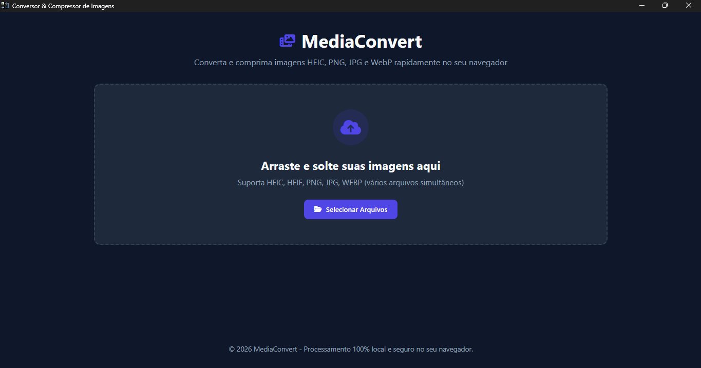
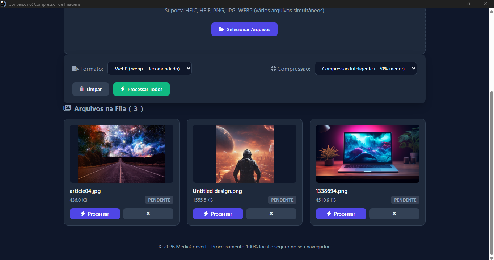

# MediaConvert

### Sobre:

- O Media Convert foi desenvolvido por mim Amanda Junqueira com o objetivo de facilitar a conversão e melhora da qualidade de imagens do setor de jornalismo do [Jornal Panorama](https://jornalpanoramaminas.com.br/), porém, aceito sugestões e ajuda para melhorar o programa.

### As funções do programa incluem:
- Compressão inteligente deixando a imagem com 70% a menos de peso;
- Ajuste de qualidade para melhor nitidez;
- Possibilidade de converter diversas imagens ao mesmo tempo
- Possibilidade de converter imagens para Webp, JPG e PNG;
- Possibilidade de baixar tudo em zip

### Download do programa:

  
  Um aplicativo de desktop rápido e moderno para conversão de imagens construído com Electron.

  <!-- Badge de Download Direto para a última Release -->
  

### Interface:

  

  

  

  

